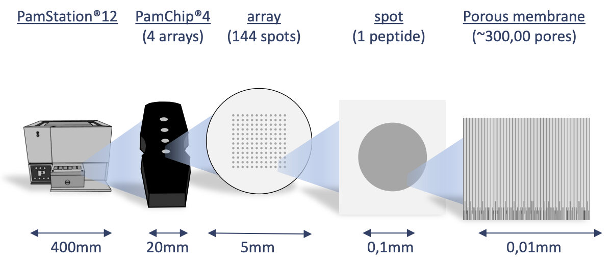
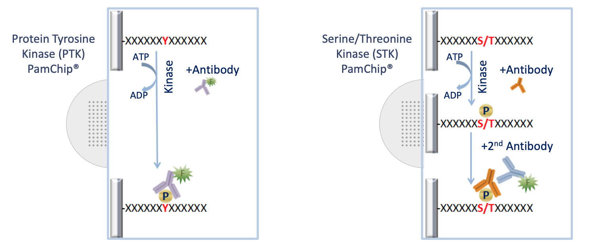

```{r}
#| label: "setup"
#| include: FALSE
if (!is.null(params[["figure_output"]])) dir.create(params[["figure_output"]], recursive = TRUE, showWarnings = FALSE)
library(KRSA)
library(knitr)
library(tidyverse)

library(gt) # nolint: unused_import_linter.
library(furrr) # nolint: unused_import_linter.

knitr::opts_chunk$set( # nolint: extraction_operator_linter.
  collapse = TRUE,
  comment = "#>",
  cache = FALSE,
  echo = FALSE,
  message = FALSE,
  warning = FALSE
)


# Modify the prefix if pairwise

prefix <- params[["prefix"]]

if (params[["pairwise"]]) {
  prefix <- str_c(prefix, "p-w", sep = "_")
}

```

# Introduction

## Background

The Pamstation12 instrument provides a profiling of kinase activity of cell or tissue samples. The device is loaded with either serine/threonine or tyrosine microarray chips. Each chip has 4 wells, so four samples can be loaded on a single chip, and the Pamstation12 can accommodate 3 chips per run. The microarray represents 144 (STK chip) or 196 (PTK chip) reporter peptides that can be phosphorylated by serine/threonine or tyrosine kinases. The device measures the degree of the phosphorylation in real time by detecting fluorescent labeled antibodies at different exposure times. The list of peptides present in each microarray can be viewed here: [STK chip](https://pamgene.com/wp-content/uploads/2020/09/STK-144-PamChip-87102.pdf), [PTK chip](https://pamgene.com/wp-content/uploads/2020/09/PTK-196-PamChip-86402.pdf)

\newpage

{fig-align="center"}

{fig-align="center"}

# Run Design

Designing the placement of the samples on the chips and arrays is important to consider due to the variability across different chips and batches. During the run some wells are subject to fail and their data cannot be analyzed and shown below as red.

```{r}
#| label: "design"
#| fig-width: 4
#| fig-height: 4

tt <- tibble(
  num = rep(c(3.5, 2.5, 1.5, 0.5), 3L),
  chips = rep(c(2L, 5L, 8L), each = 4L),
  colr = c(rep(1L, 12L)),
  nms = rep(LETTERS[1L:4L], 3L)
)
rundes <- ggplot() +
  geom_rect(aes(xmin = 1L, xmax = 3L, ymin = 0L, ymax = 4L), fill = "gray30") +
  geom_rect(aes(xmin = 4L, xmax = 6L, ymin = 0L, ymax = 4L), fill = "gray30") +
  geom_rect(aes(xmin = 7L, xmax = 9L, ymin = 0L, ymax = 4L), fill = "gray30") +
  xlim(0L, 10L) +
  theme_void()

rundes + geom_point(
  data = tt, aes(chips, num, color = factor(colr)),
  size = 13L, show.legend = FALSE
) +
  geom_text(data = tt, aes(chips, num, label = nms), size = 1.6) +
  scale_color_manual(values = c("green3", "red3"))
```

# Results

## Image Analysis

The first step of analyzing the run is to convert the images taken by the PamStation of each array at different exposure times to numerical values. This is done by the Bionavigator software developed by PamGene. The software recognizes the grid of the array with the aid of the searching algorithm (Pamgrid) to correctly identify each spot on the array. The numbers produced by this software represent the median value of the foreground pixels minus the median value of the background pixels to produce the median signal minus background (Median_SigmBg).

## Reading Data

The first step will be reading the crosstab view bionavigator files (Median_SigmBg and Signal_Saturation) and defining the PamChip type (STK or PTK). The raw data is read and then transformed to be in tidy format for an easier analysis, modeling, and visualizing.

```{r}
#| label: "read-data"

run_prefix <- prefix

chipType <- params[["chip_type"]]

# Read crosstab view bionavigator files and tidy data
raw_data <- krsa_read(
  signal_file = params[["signal_file"]],
  signal_saturation = params[["saturation_file"]]
)
```

## Initial sample preparation

The raw measurements are processed once using KRSA's initial QC routine. Sample
identifiers and group labels are retained for both exposure-time branches.
The downstream model and comparisons will use the **corrected branch's final
peptide list**, rather than re-running independent filters.

```{r}
#| label: "quality-control"

qc_data <- krsa_qc_steps(raw_data) %>%
  dplyr::mutate(
    OriginalSampleName = stringr::str_trim(as.character(SampleName)),
    Barcode = as.character(Barcode),
    SampleName = paste0(OriginalSampleName, "_", Barcode),
    Group = stringr::str_remove(OriginalSampleName, "-[0-9]+$")
  ) %>%
  dplyr::filter(SampleName != "ShHSFi-C-2_710490208")

groups <- unique(qc_data$Group)
if (length(groups) < 4L) {
  stop("Expected at least four groups for the configured comparisons; found: ",
       paste(groups, collapse = ", "))
}
included_groups <- groups
```

# Objective

This analysis evaluates whether inclusion of the 100-ms exposure affects raw
signal behavior, exposure-response linearity, and peptide retention through the
standard KRSA quality-control pipeline. A corrected branch excluding 100 ms is
compared with the original branch that includes exposures through 100 ms.

```{r exposure-child-settings, include=FALSE}
knitr::opts_chunk$set(
  echo = FALSE,
  message = FALSE,
  warning = FALSE
)
```

```{r}
#| label: exposure-qc-settings
#| include: false

# All experiment settings come from the parent.
chip_type <- params[["chip_type"]]
signal_threshold <- params[["signal_threshold"]]
linearity_threshold <- params[["linearity_threshold"]]
absolute_delta_threshold <- params[["absolute_delta_threshold"]]
z_score_threshold <- params[["z_score_threshold"]]
corrected_max_exposure <- params[["corrected_max_exposure"]]
original_max_exposure <- params[["original_max_exposure"]]
output_dir <- params[["output_dir"]]

dir.create(
  output_dir,
  recursive = TRUE,
  showWarnings = FALSE
)

if (corrected_max_exposure >= original_max_exposure) {
  stop("corrected_max_exposure must be below original_max_exposure.")
}

if (
  !is.character(output_dir) ||
  length(output_dir) != 1L ||
  is.na(output_dir) ||
  !nzchar(trimws(output_dir))
) {
  stop("Specify a valid output_dir in the parent parameters.")
}

dir.create(
  output_dir,
  recursive = TRUE,
  showWarnings = FALSE
)

if (!dir.exists(output_dir)) {
  stop("Could not create the output directory: ", output_dir)
}

```

```{r prepare-data, echo=FALSE}
# Perform the standard initial KRSA data preparation.
qc_data <- qc_data %>%
  dplyr::mutate(
    ExposureTime = suppressWarnings(as.numeric(ExposureTime)),
    Cycle = suppressWarnings(as.numeric(Cycle)),
    Signal = suppressWarnings(as.numeric(Signal)),
    Barcode = as.character(Barcode),

    Group = as.character(Group),
    SampleName = as.character(SampleName)
  ) %>%
  dplyr::filter(
    Group %in% included_groups,
    is.finite(ExposureTime),
    is.finite(Cycle),
    is.finite(Signal),
    !is.na(Peptide),
    nzchar(as.character(Peptide))
  )
qc_data %>%
  distinct(Group, SampleName, Barcode) %>%
  count(Group, name = "n_samples")

# Confirm that group selection and initial filtering retained data.
if (nrow(qc_data) == 0) {
  stop(
    "No data remain after preparation. Check included_groups, ",
    "group annotations, and the input measurements."
  )
}

missing_groups <- setdiff(
  included_groups,
  unique(qc_data$Group)
)

if (length(missing_groups) > 0) {
  stop(
    "Requested groups are absent after preparation: ",
    paste(missing_groups, collapse = ", ")
  )
}

# Define the analytical denominator once by removing reference and artificial control peptides. 
# The same denominator is used in all branch comparisons.
analytical_peptides <- qc_data$Peptide %>%
  as.character() %>%
  unique() %>%
  krsa_filter_ref_pep() %>%
  as.character() %>%
  unique()

analytical_peptides <- analytical_peptides[
  !is.na(analytical_peptides) & nzchar(analytical_peptides)
]

qc_data_analytical <- qc_data %>%
  filter(Peptide %in% analytical_peptides)

# Use a user-specified final cycle when provided.
# Otherwise, use the chip-specific endpoint: STK = 124; PTK = 94.

report_cycle <- if (!is.null(params[["final_cycle"]])) {
  as.numeric(params[["final_cycle"]])
} else {
  switch(
    toupper(chip_type),
    STK = 124,
    PTK = 94,
    stop("chip_type must be STK or PTK.")
  )
}
 # One shared endpoint cycle is used for plots and both QC branches.
if (
  length(report_cycle) != 1L ||
  !is.finite(report_cycle) ||
  !report_cycle %in% qc_data_analytical$Cycle
) {
  stop("The requested final cycle is invalid or absent from the data.")
}

dataset_summary <- tibble(
  Metric = c(
    "Chip type",
    "Samples",
    "Barcodes",
    "Analytical peptides",
    "Available exposure times (ms)",
    "Cycle used for exposure plots",
    "Signal threshold",
    "Linearity threshold"
  ),
  Value = c(
    chip_type,
    n_distinct(qc_data_analytical$SampleName),
    n_distinct(qc_data_analytical$Barcode),
    length(analytical_peptides),
    paste(sort(unique(qc_data_analytical$ExposureTime)), collapse = ", "),
    report_cycle,
    signal_threshold,
    linearity_threshold
  )
)

```

# Dataset overview

```{r dataset-summary}
knitr::kable(
  dataset_summary,
  col.names = c("Dataset characteristic", "Value"),
  align = c("l", "l")
)
```

# Custom cycle-level quality control

Because the 100-ms images are suspected to be overexposed, the preliminary
high-signal screen uses exposures through 50 ms. This screen selects measurable
peptides for cycle-level anomaly detection; it is not the final KRSA peptide
filter.

For each sample, barcode, peptide, and cycle, the model
\(Signal = slope \times ExposureTime\) is fitted through the origin. Consecutive
cycles are compared using the change in transformed slope. A transition fails
when its absolute delta exceeds 2.5, or when its peptide-specific absolute
z-score exceeds 3 and either adjacent model has \(R^2 < 0.8\).

```{r endpoint-helpers, include=FALSE}
extract_selected_endpoint <- function(data, final_cycle) {

  endpoint <- data %>%
    dplyr::filter(Cycle == final_cycle)

  if (nrow(endpoint) == 0) {
    stop("No endpoint measurements remain at cycle ", final_cycle, ".")
  }

  # Require each analytical sample/barcode to have some data
  # at the selected cycle. Never substitute an earlier cycle.
  expected_samples <- data %>%
    dplyr::filter(Peptide %in% analytical_peptides) %>%
    dplyr::distinct(SampleName, Barcode)

  available_samples <- endpoint %>%
    dplyr::filter(Peptide %in% analytical_peptides) %>%
    dplyr::distinct(SampleName, Barcode)

  missing_samples <- dplyr::anti_join(
    expected_samples,
    available_samples,
    by = c("SampleName", "Barcode")
  )

  if (nrow(missing_samples) > 0) {
    stop(
      "Selected cycle ", final_cycle,
      " is missing for these sample/barcode combinations: ",
      paste(
        paste(missing_samples$SampleName,
              missing_samples$Barcode, sep = " / "),
        collapse = ", "
      )
    )
  }

  # Keep the same endpoint columns expected by the existing pipeline.
  endpoint %>%
    dplyr::select(
      SampleName, Peptide, ExposureTime,
      Signal, Barcode, Group
    )
}

extract_selected_max_endpoint <- function(
    data, final_cycle, endpoint_exposure
) {

  endpoint <- extract_selected_endpoint(data, final_cycle)

  selected <- endpoint %>%
    dplyr::filter(ExposureTime == endpoint_exposure)

  if (nrow(selected) == 0) {
    stop(
      "No observed ", endpoint_exposure,
      "-ms measurements remain at cycle ", final_cycle, "."
    )
  }

  selected %>%
  dplyr::select(SampleName, Peptide, Signal, Group)
}
```

```{r cycle-qc-calculation, echo=FALSE}
# Restrict preliminary cycle QC to analytical peptides and exposures through 50 ms so that the problematic 100-ms measurements cannot influence it.
qc_data_cycle_qc <- qc_data_analytical %>%
  filter(ExposureTime <= corrected_max_exposure)

data_pw_max_initial <- extract_selected_max_endpoint(
  qc_data_cycle_qc,
  final_cycle = report_cycle,
  endpoint_exposure = corrected_max_exposure
)

high_peptides_initial <- krsa_filter_lowPeps(
  data_pw_max_initial,
  signal_threshold
)

# Fit one exposure-response model per sample/barcode/peptide/cycle.
slopes_per_cycle <- qc_data_cycle_qc %>%
  filter(Peptide %in% high_peptides_initial) %>%
  select(
    SampleName,
    Peptide,
    Group,
    Barcode,
    Cycle,
    ExposureTime,
    Signal
  ) %>%
  nest(
    data = -c(SampleName, Peptide, Group, Barcode, Cycle)
  ) %>%
  mutate(
    fit = map(
      data,
      ~ lm(Signal ~ ExposureTime + 0, data = .x)
    ),
    slope_raw = map_dbl(
      fit,
      ~ {
        estimate <- coef(.x)[["ExposureTime"]]
        if (length(estimate) == 0) NA_real_ else as.numeric(estimate)
      }
    ),
    r.sq = map_dbl(fit, ~ summary(.x)$r.squared)
  ) %>%
  select(-data, -fit) %>%
  mutate(
    slope_transformed = if_else(
      is.finite(slope_raw) & slope_raw > 0,
      log2(slope_raw * 100),
      NA_real_
    ),
    slope = if_else(
      is.finite(slope_transformed) & slope_transformed >= 0,
      slope_transformed,
      NA_real_
    )
  )
# Negative values mean predicted signal is between 0 and 1.
# slope: replaces negative transformed values with NA, matching KRSA's convention.
# slope_transformed preserves negative log₂ values so they can be used to compare changes between cycles.
# Both columns are identical for finite transformed values >= 0.

delta_slopes <- slopes_per_cycle %>%
  arrange(SampleName, Barcode, Peptide, Cycle) %>%
  group_by(SampleName, Barcode, Peptide) %>%
  mutate(
    prev_slope = lag(slope_transformed),
    prev_r.sq = lag(r.sq),
    delta = slope_transformed- prev_slope
  ) %>%
  ungroup() %>%
  filter(is.finite(delta))

# Apply the absolute, adaptive, and model-fit QC criteria.
qc_flags <- delta_slopes %>%
  group_by(Peptide) %>%
  mutate(
    peptide_mean = mean(delta, na.rm = TRUE),
    peptide_sd = sd(delta, na.rm = TRUE),
    z_score = case_when(
      is.finite(peptide_sd) & peptide_sd > 0 ~
        abs((delta - peptide_mean) / peptide_sd),
      TRUE ~ 0
    ),
    flag_absolute = abs(delta) > absolute_delta_threshold,
    flag_zscore = z_score > z_score_threshold,
    flag_missing_fit = !is.finite(r.sq) | !is.finite(prev_r.sq),
    flag_poor_fit =
      coalesce(r.sq < linearity_threshold, TRUE) |
      coalesce(prev_r.sq < linearity_threshold, TRUE)
  ) %>%
  ungroup() %>%
  mutate(
    qc_fail = flag_absolute | (flag_zscore & flag_poor_fit),
    failure_reason = case_when(
      flag_absolute & flag_zscore & flag_poor_fit ~
        "Absolute and adaptive criteria",
      flag_absolute ~ "Absolute delta criterion",
      flag_zscore & flag_poor_fit ~ "Z-score and poor fit",
      flag_missing_fit ~ "Missing fit information; retained",
      flag_zscore ~ "Z-score only; retained",
      flag_poor_fit ~ "Poor fit only; retained",
      TRUE ~ "No flag"
    )
  )

cycle_transition_summary <- qc_flags %>%
  count(qc_fail, failure_reason, name = "Transitions")

# Remove all exposure observations belonging to failed peptide-cycle keys.
bad_rows <- qc_flags %>%
  filter(qc_fail) %>%
  distinct(SampleName, Barcode, Peptide, Cycle)

qc_data_clean <- qc_data %>%
  anti_join(
    bad_rows,
    by = c("SampleName", "Barcode", "Peptide", "Cycle")
  )

cycle_qc_summary <- tibble(
  Metric = c(
    "Evaluated cycle transitions",
    "Failed transitions",
    "Failed peptide-cycle combinations",
    "Measurement rows removed",
    "Measurement rows retained"
  ),
  Value = c(
    nrow(qc_flags),
    sum(qc_flags$qc_fail, na.rm = TRUE),
    nrow(bad_rows),
    nrow(qc_data) - nrow(qc_data_clean),
    nrow(qc_data_clean)
  )
)
```

```{r cycle-qc-summary}
knitr::kable(
  cycle_qc_summary,
  col.names = c("Cycle-level QC metric", "Result"),
  align = c("l", "l")
)
```

```{r cycle-qc-plot}
ggplot(
  qc_flags,
  aes(
    x = factor(Cycle),
    y = delta,
    color = qc_fail
  )
) +
  geom_jitter(width = 0.2, alpha = 0.55, size = 1.3) +
  geom_hline(
    yintercept = c(-absolute_delta_threshold, absolute_delta_threshold),
    linetype = "dashed",
    color = "firebrick"
  ) +
  scale_color_manual(
    values = c(`FALSE` = "#2C7FB8", `TRUE` = "#D7301F"),
    labels = c(`FALSE` = "Retained", `TRUE` = "Removed")
  ) +
  labs(
    title = "Cycle-to-cycle slope-change quality control",
    x = "Current cycle",
    y = expression(Delta ~ "transformed slope"),
    color = "QC decision"
  ) +
  theme_bw() +
  theme(legend.position = "bottom")
```

The failed peptide-cycle combinations were removed before creating either
exposure-time branch, ensuring that both branches start from the same cleaned
dataset.

# Exposure-time behavior at the final cycle

The following plots use unmodeled signal values from cycle `r report_cycle` and
exclude reference/control peptides. Conditions and replicates are taken from
the data; no study-specific group names are hard-coded.

```{r prepare-exposure-plots, echo=FALSE}
exposure_plot_data <- qc_data_clean %>%
  filter(
    Cycle == report_cycle,
    Peptide %in% analytical_peptides
  )

# Prefer an explicit Replicate column. If it is unavailable, use SampleName as the replicate/sample label without assuming any naming convention.
has_explicit_replicate <- "Replicate" %in% names(exposure_plot_data)

if (has_explicit_replicate) {
  exposure_plot_data <- exposure_plot_data %>%
    mutate(Replicate = as.character(Replicate))
} else {
  exposure_plot_data <- exposure_plot_data %>%
    mutate(Replicate = SampleName)
}

exposure_plot_data <- exposure_plot_data %>%
  filter(
    is.finite(ExposureTime),
    is.finite(Signal),
    !is.na(Group),
    nzchar(Group),
    !is.na(Replicate),
    nzchar(Replicate)
  ) %>%
  group_by(
    SampleName,
    Barcode,
    Group,
    Replicate,
    Peptide,
    ExposureTime
  ) %>%
  summarise(
    raw_signal = median(Signal, na.rm = TRUE),
    .groups = "drop"
  ) %>%
  mutate(
    Group = forcats::fct_inorder(Group),
    Replicate = forcats::fct_inorder(Replicate)
  )

available_exposures <- sort(unique(exposure_plot_data$ExposureTime))

median_signal_summary <- exposure_plot_data %>%
  group_by(SampleName, Barcode, Group, Replicate, ExposureTime) %>%
  summarise(
    median_raw_signal = median(raw_signal, na.rm = TRUE),
    .groups = "drop"
  )

measurable_peptide_summary <- exposure_plot_data %>%
  group_by(SampleName, Barcode, Group, Replicate, ExposureTime) %>%
  summarise(
    measurable_peptides = n_distinct(
      Peptide[raw_signal >= signal_threshold]
    ),
    .groups = "drop"
  )

# Pair 50- and 100-ms measurements within each sample and peptide.
signal_50_100 <- exposure_plot_data %>%
  filter(
    ExposureTime %in% c(corrected_max_exposure, original_max_exposure)
  ) %>%
  select(
    SampleName,
    Barcode,
    Group,
    Replicate,
    Peptide,
    ExposureTime,
    raw_signal
  ) %>%
  pivot_wider(
    names_from = ExposureTime,
    values_from = raw_signal,
    names_prefix = "signal_"
  )

corrected_signal_column <- paste0("signal_", corrected_max_exposure)
original_signal_column <- paste0("signal_", original_max_exposure)

missing_signal_columns <- setdiff(
  c(corrected_signal_column, original_signal_column),
  names(signal_50_100)
)

if (length(missing_signal_columns) > 0) {
  stop(
    "The final-cycle data are missing required exposure columns: ",
    paste(missing_signal_columns, collapse = ", ")
  )
}

signal_50_100 <- signal_50_100 %>%
  mutate(
    signal_corrected = .data[[corrected_signal_column]],
    signal_original = .data[[original_signal_column]],
    measured_at_both =
      is.finite(signal_corrected) & is.finite(signal_original),
    measurable_at_50 =
      measured_at_both & signal_corrected >= signal_threshold,
    measurable_at_100 =
      measured_at_both & signal_original >= signal_threshold,
    lost_measurable_signal =
      measurable_at_50 & signal_original < signal_threshold,
    gained_measurable_signal =
      measured_at_both &
      signal_corrected < signal_threshold &
      signal_original >= signal_threshold,
    lower_at_100 =
      measured_at_both & signal_original < signal_corrected,
    drop_at_least_50_percent =
      measured_at_both &
      signal_corrected > 0 &
      signal_original <= 0.5 * signal_corrected
  )

signal_loss_summary <- signal_50_100 %>%
  group_by(SampleName, Barcode, Group, Replicate) %>%
  summarise(
    paired_peptides = sum(measured_at_both, na.rm = TRUE),
    measurable_at_50 = sum(measurable_at_50, na.rm = TRUE),
    measurable_at_100 = sum(measurable_at_100, na.rm = TRUE),
    peptides_lost = sum(lost_measurable_signal, na.rm = TRUE),
    peptides_gained = sum(gained_measurable_signal, na.rm = TRUE),
    lower_at_100 = sum(lower_at_100, na.rm = TRUE),
    drop_at_least_50_percent = sum(
      drop_at_least_50_percent,
      na.rm = TRUE
    ),
    .groups = "drop"
  ) %>%
  mutate(
    percent_lost = if_else(
      measurable_at_50 > 0,
      100 * peptides_lost / measurable_at_50,
      NA_real_
    ),
    plot_label = if (has_explicit_replicate) {
      paste(Group, Replicate, sep = " – ")
    } else {
      SampleName
    },
    plot_label = forcats::fct_inorder(plot_label)
  )
```

## Median raw signal versus exposure time

```{r median-signal-plot}
ggplot(
  median_signal_summary,
  aes(
    x = ExposureTime,
    y = median_raw_signal,
    color = Replicate,
    group = SampleName
  )
) +
  geom_line(linewidth = 0.8) +
  geom_point(size = 2.2) +
  scale_x_continuous(breaks = available_exposures) +
  facet_wrap(~ Group, scales = "free_y") +
  labs(
    title = "Median raw signal across exposure times",
    x = "Exposure time (ms)",
    y = "Median raw signal",
    color = "Replicate/sample"
  ) +
  theme_bw() +
  theme(
    legend.position = "bottom",
    strip.text = element_text(face = "bold")
  )
```

This plot shows whether median signal increases consistently with exposure time
or declines at the 100-ms exposure within individual samples.

## Number of measurable peptides versus exposure time

```{r measurable-peptides-plot}
ggplot(
  measurable_peptide_summary,
  aes(
    x = ExposureTime,
    y = measurable_peptides,
    color = Replicate,
    group = SampleName
  )
) +
  geom_line(linewidth = 0.8) +
  geom_point(size = 2.2) +
  scale_x_continuous(breaks = available_exposures) +
  scale_y_continuous(
    limits = c(0, length(analytical_peptides)),
    breaks = scales::pretty_breaks()
  ) +
  facet_wrap(~ Group) +
  labs(
    title = "Number of measurable peptides across exposure times",
    subtitle = paste0("Measurable raw signal ≥ ", signal_threshold),
    x = "Exposure time (ms)",
    y = "Number of measurable peptides",
    color = "Replicate/sample"
  ) +
  theme_bw() +
  theme(
    legend.position = "bottom",
    strip.text = element_text(face = "bold")
  )
```

This plot evaluates whether longer exposure improves peptide detection or causes
the number of measurable peptides to fall at 100 ms.

## Peptides losing measurable signal from 50 to 100 ms

Only peptides measured at both exposure times enter this calculation. Signal
loss is defined as signal ≥`r signal_threshold` at 50 ms followed by signal <`r signal_threshold` at 100 ms. The
percentage denominator is the number of paired peptides measurable at 50 ms.

```{r}
#| label: signal-loss-barplot
#| fig-width: 12
#| fig-height: 8.5
#| out-width: 100%
ggplot(
  signal_loss_summary,
  aes(
    x = plot_label,
    y = peptides_lost,
    fill = Group
  )
) +
  geom_col(
    width = 0.75,
    color = "black",
    linewidth = 0.25
  ) +
  geom_text(
    aes(
      label = paste0(
        peptides_lost,
        "\n(",
        sprintf("%.1f", percent_lost),
        "%)"
      )
    ),
    vjust = -0.3,
    size = 3.3,
    lineheight = 0.9
  ) +
  scale_y_continuous(
    breaks = scales::pretty_breaks(),
    expand = expansion(mult = c(0, 0.30))
  ) +
  coord_cartesian(clip = "off") +
  labs(
    title = "Peptides losing measurable signal at 100 ms",
    subtitle = paste0(
      "Labels show number lost and percentage of peptides ",
      "measurable at 50 ms"
    ),
    x = "PDCL5 sample",
    y = "Number of peptides losing measurable signal",
    fill = "Groups"
  ) +
  theme_bw() +
  theme(
    axis.text.x = element_text(
      angle = 45,
      hjust = 1,
      vjust = 1
    ),
    legend.position = "bottom",
    plot.margin = margin(
      t = 15,
      r = 10,
      b = 35,
      l = 10
    )
  )
```

# Standard KRSA QC in the two exposure branches

The observed-100-ms branch uses the standard KRSA pipeline. In the corrected branch, exposure-response models are fitted using observed measurements through 50 ms, the fitted slopes are extrapolated to obtain predicted 100-ms signals for low-signal filtering, and linearity is evaluated using observed measurements only.

```{r branch-calculation, include=FALSE}
run_standard_krsa_qc <- function(
    data,
    max_exposure,
    chip_type,
    signal_threshold,
    linearity_threshold,
    final_cycle
) {

  data_branch <- data %>%
    dplyr::filter(
      is.finite(ExposureTime),
      ExposureTime <= max_exposure
    )

  data_pw_max <- extract_selected_max_endpoint(
  data_branch,
  final_cycle = final_cycle,
  endpoint_exposure = max_exposure
)

data_pw <- extract_selected_endpoint(
  data_branch,
  final_cycle = final_cycle
)

  high_peptides <- krsa_filter_lowPeps(
    data_pw_max,
    as.integer(signal_threshold)
  )
  

  data_modeled <- krsa_scaleModel(
    data_pw,
    high_peptides
  )

  linear_peptides <- krsa_filter_nonLinear(
    data_modeled[["scaled"]],
    linearity_threshold
  )

  clean_peptides <- krsa_filter_ref_pep(
    linear_peptides
  )

  list(
    max_exposure = max_exposure,
    target_exposure = max_exposure,
    endpoint_type = "Observed endpoint",
    data_branch = data_branch,
    data_pw_max = data_pw_max,
    data_pw = data_pw,
    high_peptides = high_peptides,
    data_modeled = data_modeled,
    linear_peptides = linear_peptides,
    clean_peptides = clean_peptides
  )
}

run_extrapolated_krsa_qc <- function(
    data,
    max_observed_exposure = 50,
    target_exposure = 100,
    chip_type,
    signal_threshold,
    linearity_threshold,
    final_cycle
) {

  # Remove the observed 100-ms measurements
  data_branch <- data %>%
    dplyr::filter(
      is.finite(ExposureTime),
      ExposureTime <= max_observed_exposure
    )

  # Extract final-cycle observations through 50 ms
 data_pw <- extract_selected_endpoint(
  data_branch,
  final_cycle = final_cycle
)

  # Fit the same through-origin model used by KRSA,
  # then extrapolate raw signal to 100 ms
  predicted_endpoint_100 <- data_pw %>%
    dplyr::group_by(
      SampleName,
      Peptide,
      Group,
      Barcode
    ) %>%
    tidyr::nest() %>%
    dplyr::mutate(
      fit = purrr::map(
        data,
        ~ stats::lm(
          Signal ~ ExposureTime + 0,
          data = .x
        )
      ),
      slope_raw = purrr::map_dbl(
        fit,
        ~ {
          estimate <- stats::coef(.x)[["ExposureTime"]]

          if (
            length(estimate) == 0 ||
            !is.finite(estimate)
          ) {
            NA_real_
          } else {
            as.numeric(estimate)
          }
        }
      ),
      Signal = slope_raw * target_exposure,
      ExposureTime = target_exposure
    ) %>%
    dplyr::ungroup() %>%
    dplyr::select(
      SampleName,
      Peptide,
      Group,
      Barcode,
      ExposureTime,
      Signal,
      slope_raw
    )

  # krsa_filter_lowPeps requires one predicted signal
  # for every sample and peptide
  predicted_endpoint_for_filter <- predicted_endpoint_100 %>%
    dplyr::select(
      SampleName,
      Peptide,
      Group,
      Signal
    )

  # Apply signal threshold to predicted 100-ms values
  high_peptides <- krsa_filter_lowPeps(
    predicted_endpoint_for_filter,
    as.integer(signal_threshold)
  )

  # Model only the real observations through 50 ms
  # KRSA internally calculates log2(slope × 100)
  data_modeled <- krsa_scaleModel(
    data_pw,
    high_peptides
  )

  # Assess linearity using only real exposures through 50 ms
  linear_peptides <- krsa_filter_nonLinear(
    data_modeled[["scaled"]],
    linearity_threshold
  )

  clean_peptides <- krsa_filter_ref_pep(
    linear_peptides
  )

  list(
    max_exposure = max_observed_exposure,
    target_exposure = target_exposure,
    endpoint_type = "Predicted from exposures through 50 ms",
    data_branch = data_branch,
    data_pw = data_pw,
    data_pw_max = predicted_endpoint_for_filter,
    predicted_endpoint_100 = predicted_endpoint_100,
    high_peptides = high_peptides,
    data_modeled = data_modeled,
    linear_peptides = linear_peptides,
    clean_peptides = clean_peptides
  )
}

filters_100 <- run_standard_krsa_qc(
  data = qc_data_clean,
  max_exposure = original_max_exposure,
  chip_type = chip_type,
  signal_threshold = signal_threshold,
  linearity_threshold = linearity_threshold,
  final_cycle = report_cycle
)

filters_extrapolated_100 <- run_extrapolated_krsa_qc(
  data = qc_data_clean,
  max_observed_exposure = corrected_max_exposure,
  target_exposure = original_max_exposure,
  chip_type = chip_type,
  signal_threshold = signal_threshold,
  linearity_threshold = linearity_threshold,
  final_cycle = report_cycle
)

count_analytical <- function(peptides) {
  length(unique(intersect(as.character(peptides), analytical_peptides)))
}

clean_peptides_observed_100 <- unique(intersect(
  as.character(filters_100$clean_peptides),
  analytical_peptides
))

clean_peptides_extrapolated_100 <- unique(intersect(
  as.character(filters_extrapolated_100$clean_peptides),
  analytical_peptides
))

passed_both <- intersect(clean_peptides_observed_100, clean_peptides_extrapolated_100)
passed_only_extrapolated_100 <- setdiff(clean_peptides_extrapolated_100, clean_peptides_observed_100)
passed_only_observed_100 <- setdiff(clean_peptides_observed_100, clean_peptides_extrapolated_100)
failed_both <- setdiff(
  analytical_peptides,
  union(clean_peptides_observed_100, clean_peptides_extrapolated_100)
)


studywide_filter_summary <- tibble::tibble(
  Analysis = c(
    "Observed through 100 ms",
    "Predicted 100 ms from observed exposures through 50 ms"
  ),
  `Maximum observed exposure` = c("100 ms", "50 ms"),
  `Low-signal endpoint` = c("Observed 100 ms", "Predicted 100 ms"),
  `Total analytical peptides` = length(analytical_peptides),
  `Passed low-signal filter` = c(
    count_analytical(filters_100$high_peptides),
    count_analytical(filters_extrapolated_100$high_peptides)
  ),
  `Passed linearity filter` = c(
    count_analytical(filters_100$linear_peptides),
    count_analytical(filters_extrapolated_100$linear_peptides)
  ),
  `Passed all KRSA filters` = c(
    length(clean_peptides_observed_100),
    length(clean_peptides_extrapolated_100)
  )
)

peptide_qc_comparison <- tibble::tibble(
  Peptide = analytical_peptides
) %>%
  dplyr::mutate(
    passed_observed_100 =
      Peptide %in% clean_peptides_observed_100,

    passed_extrapolated_100 =
      Peptide %in% clean_peptides_extrapolated_100,

    passed_low_signal_observed_100 =
      Peptide %in% filters_100$high_peptides,

    passed_low_signal_extrapolated_100 =
      Peptide %in% filters_extrapolated_100$high_peptides,

    passed_linearity_observed_100 =
      Peptide %in% filters_100$linear_peptides,

    passed_linearity_extrapolated_100 =
      Peptide %in% filters_extrapolated_100$linear_peptides,

    classification = dplyr::case_when(
      passed_observed_100 & passed_extrapolated_100 ~
        "Passed both",

      !passed_observed_100 & passed_extrapolated_100 ~
        "Passed only with predicted 100 ms",

      passed_observed_100 & !passed_extrapolated_100 ~
        "Passed only with observed 100 ms",

      TRUE ~ "Failed both"
    )
  )


classification_order <- c(
  "Passed both",
  "Passed only with predicted 100 ms",
  "Passed only with observed 100 ms",
  "Failed both"
)

peptide_classification_summary <- peptide_qc_comparison %>%
  mutate(
    classification = factor(classification, levels = classification_order)
  ) %>%
  count(classification, name = "Peptides", .drop = FALSE) %>%
  arrange(classification)
```


```{r branch-summary-table}
knitr::kable(
  studywide_filter_summary,
  align = c("l", "l", "l", "r", "r", "r", "r")
)
```

The corrected analysis, which fits exposure-response models using observed measurements through 50 ms and uses the predicted 100-ms signal for low-signal filtering, retains **`r length(clean_peptides_extrapolated_100)`** of
**`r length(analytical_peptides)`** analytical peptides after all KRSA filters,
compared with **`r length(clean_peptides_observed_100)`** when 100 ms is included.

# Final peptide-list comparison

```{r peptide-classification-table}
knitr::kable(
  peptide_classification_summary,
  col.names = c("Final peptide status", "Number of peptides"),
  align = c("l", "r")
)
```

The corrected-branch-specific set contains **`r length(passed_only_extrapolated_100)`**
peptides that pass all KRSA filters only when the predicted 100-ms endpoint,
derived from observed exposures through 50 ms, is used. Conversely,
**`r length(passed_only_observed_100)`** peptides pass only when the observed 100-ms
measurements are included. These classifications describe changes in QC
retention; they do not, by themselves, prove detector saturation.

# Conclusion

The branch comparison quantifies how exclusion of the problematic 100-ms
measurements changes final KRSA peptide retention. The paired well-level analysis
provides complementary evidence by identifying measurements that are detectable
at 50 ms but fall below the signal threshold at 100 ms. A peptide that passes
only in the corrected branch and repeatedly loses signal at 100 ms provides
stronger evidence of exposure-associated measurement distortion than either
result alone.

# Detailed output files

Detailed peptide lists, fitted model tables, cycle-QC diagnostics, and paired
50-versus-100-ms measurements are saved as CSV files in:

`r normalizePath(output_dir, winslash = "/", mustWork = FALSE)`

These detailed objects are intentionally not printed as raw console output in
the main report.

```{r save-detailed-tables, include=FALSE}
# Convert vectors into one-column data frames before writing them to CSV.
vector_table <- function(x) {
  tibble(Peptide = unique(as.character(x))) %>%
    filter(!is.na(Peptide), nzchar(Peptide))
}

detailed_tables <- list(
  "cycle_transition_qc.csv" = qc_flags,
  "failed_peptide_cycles.csv" = bad_rows,
  "cycle_transition_summary.csv" = cycle_transition_summary,
  "cycle_qc_summary.csv" = cycle_qc_summary,
  "studywide_filter_summary.csv" = studywide_filter_summary,
  "peptide_qc_comparison.csv" = peptide_qc_comparison,
  "peptides_passed_both.csv" = vector_table(passed_both),
  "peptides_passed_only_predicted_100ms.csv" = vector_table(passed_only_extrapolated_100),
  "peptides_passed_only_observed_100ms.csv" = vector_table(passed_only_observed_100),
  "peptides_failed_both.csv" = vector_table(failed_both),
  "high_signal_peptides_100ms.csv" = vector_table(
    filters_100$high_peptides
  ),
  "linear_peptides_100ms.csv" = vector_table(
    filters_100$linear_peptides
  ),
  "clean_peptides_observed_100ms.csv" = vector_table(
    filters_100$clean_peptides
  ),
  "scaled_model_100ms.csv" = filters_100$data_modeled[["scaled"]],
  "high_signal_peptides_predicted_100_from_50ms.csv" = vector_table(
    filters_extrapolated_100$high_peptides
  ),
  "linear_peptides_observed_through_50ms.csv" = vector_table(
    filters_extrapolated_100$linear_peptides
  ),
  "clean_peptides_extrapolated_100_from_50ms.csv" = vector_table(
    filters_extrapolated_100$clean_peptides
  ),
  "scaled_model_observed_through_50ms.csv" = filters_extrapolated_100$data_modeled[["scaled"]],
  "paired_signal_50_100ms.csv" = signal_50_100,
  "well_level_signal_loss_summary.csv" = signal_loss_summary,
  "median_signal_by_exposure.csv" = median_signal_summary,
  "measurable_peptides_by_exposure.csv" = measurable_peptide_summary
)

purrr::iwalk(
  detailed_tables,
  ~ readr::write_csv(.x, file.path(output_dir, .y), na = "")
)
saveRDS(
  filters_extrapolated_100,
  file.path(
    output_dir,
    paste0(
      "PDCL5_KRSA_QC_extrapolated_100_from_50ms.rds"
    )
  )
)
```


## QC-selected peptides and model fitting

**All downstream analyses use the corrected QC branch.** Its low-signal filter
uses predicted 100-ms signals extrapolated from observed exposures through
50 ms; its linearity filter and fitted model use only actual exposures through
50 ms. The final peptide list is not recalculated in this section.

```{r}
#| label: "model"

# Reuse the completed corrected-branch QC outputs without refitting or refiltering.
high_peptides <- filters_extrapolated_100$high_peptides
linear_peptides <- filters_extrapolated_100$linear_peptides
clean_peptides <- clean_peptides_extrapolated_100
data_modeled <- filters_extrapolated_100$data_modeled

# Maintain the object names expected by the existing _comparison.Rmd child.
# data_pw contains REAL endpoint observations at exposures <= 50 ms.
# data_pw_max contains PREDICTED 100-ms signals for low-signal filtering.
data_pw <- filters_extrapolated_100$data_pw
data_pw_max <- filters_extrapolated_100$data_pw_max

if (!length(clean_peptides)) {
  stop("The corrected QC branch retained no peptides; downstream analysis stopped.")
}
if (!all(clean_peptides %in% as.character(filters_extrapolated_100$clean_peptides))) {
  stop("Downstream peptide selection differs from corrected-branch QC.")
}
if (any(data_pw$ExposureTime > corrected_max_exposure, na.rm = TRUE)) {
  stop("Observed 100-ms data leaked into the corrected downstream model.")
}

cat("Downstream analysis uses", length(clean_peptides),
    "corrected-QC peptides out of", length(analytical_peptides),
    "analytical peptides.\n")
```

## Global Signal Intensity

For a global signal intensity across all samples/groups, few figures can be plotted based on the *Slope_Transformed* values.

### Global CV Plots

We will plot the coefficient of variation on both the normal and normalized fits. This will help us to identify groups with high variation that could be explained by sample outliers.

```{r}
#| label: "global-cv-plot"
#| fig-width: 6
#| fig-height: 6
#| fig-cap: "Coefficient of Variation plotted for each peptide across all 4 groups"
#| eval: !expr params$pairwise
if(!is.null(params[["figure_output"]])) dir.create(params[["figure_output"]])
# Plot a CV figure using the modeled normalized data
if (!is.null(params[["figure_output"]])) {
  krsa_cv_plot(data_modeled[["normalized"]], clean_peptides) |> ggsave(filename=paste(params[["figure_output"]], "cv_plot.pdf", sep="/"))
  } else {
  krsa_cv_plot(data_modeled[["normalized"]], clean_peptides)
  }

```

### Global Violin Plots

We will plot violin figures to examine global signal differences between groups/samples.

```{r}
#| label: "global-violin-plot-by-group"
#| fig-width: 6
#| fig-height: 6
#| fig-cap: "Violin Plots for signal intensity Distribution Across Groups for all replicates"

# Plot a violin figure and facet by the (Group) variable

if (!is.null(params[["figure_output"]])) {
  krsa_violin_plot(data_modeled[["scaled"]], clean_peptides, "Group") |> ggsave(filename=paste(params[["figure_output"]], "violin_plot_bygroup.pdf", sep="/"))
  } else {
  krsa_violin_plot(data_modeled[["scaled"]], clean_peptides, "Group")
  }

```

```{r}
#| label: "global-violin-plot-by-chip"
#| fig-width: 6
#| fig-height: 6
#| fig-cap: "Violin Plots for signal intensity Distribution Across Chips for all replicates"

# Plot a violin figure and facet by the (Barcode) variable
if (!is.null(params[["figure_output"]])) {
  krsa_violin_plot(data_modeled[["scaled"]], clean_peptides, "Barcode") |> ggsave(filename=paste(params[["figure_output"]], "violin_plot_bybarcode.pdf", sep="/"))
  } else {
  krsa_violin_plot(data_modeled[["scaled"]], clean_peptides, "Barcode")
  }

```

### Global Heatmaps

The heatmap represent all the peptides present on the chip except the positive/internal controls and peptides that failed to pass QC. The heatmaps are scaled by row to highlight the peptide signal differences across the samples. A hierarchical unsupervised clustering is applied both on the peptides and the samples to group potentially similar signatures.

```{r}
#| label: "global-signal-heatmap-individual"
#| fig-cap: "Row and chip normalized intensity values for the selected peptides"
#| fig-height: 6
#| fig-width: 6

# Generates a heatmap using the modeled normalized data
nheatmap <- krsa_heatmap(data_modeled[["normalized"]], clean_peptides, scale = "row")
if (!is.null(params[["figure_output"]])) {
  graphics.off()
  pdf(file = paste(params[["figure_output"]], "normalized_heatmap.pdf", sep="/"))
  grid::grid.newpage()
  grid::grid.draw(nheatmap$gtable)
  dev.off()
} else {
  grid::grid.newpage()
  grid::grid.draw(nheatmap$gtable)
}

```

```{r}
#| label: "global-signal-heatmap-grouped"
#| fig-cap: "Row and group normalized intensity values for the selected peptides"
#| fig-height: 6
#| fig-width: 6

# Generates a heatmap using the modeled grouped data
gheatmap <- krsa_heatmap_grouped(data_modeled[["grouped"]], clean_peptides, scale = "row")
if (!is.null(params[["figure_output"]])) {
  graphics.off()
  pdf(file = paste(params[["figure_output"]], "normalized_grouped_heatmap.pdf", sep="/"))
  grid::grid.newpage()
  grid::grid.draw(gheatmap$gtable)
  dev.off()
} else {
  grid::grid.newpage()
  grid::grid.draw(gheatmap$gtable)
}
```

## Group Comparison

To compare groups, five two-group comparisons are performed using the corrected-branch modeled values and final QC-selected peptides:

- The five configured contrasts are listed in the following comparison chunk.

The *Slope_Transformed* ratio between each group, paired by chip, is calculated to the fold change. Based on the fold change, peptides that pass a certain fold change threshold are considered significant hits. Also, quality control steps applied in each comparison to filter out peptides that do not reach specific criteria:

- The predicted *Median_SigmBg* at 100 ms, extrapolated from exposures through 50 ms, must meet the signal threshold\
- $R^2$ of the linear model fit must be above a threshold value

These *Filtering Parameters* (fold change threshold, QC criteria) can be modified to adjust the stringency of the analysis. The *Filtering Parameters* that are used for this analysis:

- The predicted *Median_SigmBg* at 100 ms must be equal to or above `r signal_threshold`\
- $R^2$ of the linear model fitted through 50 ms must be at least `r linearity_threshold`\
- Log fold change (LFC) cutoffs at (0.2,0.3,0.4)

```{r}
#| label: "group-comp-list"

# You can define the comparison groups here.
# The group names are in the `groups` variable and you can use subscripting to select the groups
# For example, to compare the first and fourth groups, you can use `groups[1]` and `groups[4]`
# Then copy the next block as many times as there are comparisons and change the `COMP1` to `COMP2`, `COMP3`, etc.
# Also make sure that the label is unique for each block

# Define Groups to be compared
comparisons <- list(
  COMP1 = c(groups[[2L]], groups[[1L]]),
  COMP2 = c(groups[[3L]], groups[[1L]]),
  COMP3 = c(groups[[4L]], groups[[1L]]),
  COMP4 = c(groups[[4L]], groups[[3L]]),
  COMP5 = c(groups[[4L]], groups[[2L]])
)
```

```{r}
#| results: "asis"
#| echo: FALSE
#| include: TRUE
#| label: "childA"
#| fig-width: 6
#| fig-height: 6
#| fig-cap: "Heatmap of pairwise group comparison"

case <- comparisons[["COMP1"]][[1L]]
ctrl <- comparisons[["COMP1"]][[2L]]
random <- "A"
threshold <- params[["threshold"]]

src <- knitr::knit_expand(
  file = "_comparison.Rmd",
  case = case, ctrl = ctrl, threshold = threshold,
  figure_output = params[["figure_output"]],
  chip = params[["chip_type"]]
)

res <- knitr::knit_child(text = src, quiet = TRUE)

cat(res, sep = "\n")
```


```{r}
#| results: "asis"
#| echo: FALSE
#| include: TRUE
#| label: "childB"
#| fig-width: 6
#| fig-height: 6
#| fig-cap: "Heatmap of pairwise group comparison"

case <- comparisons[["COMP2"]][[1L]]
ctrl <- comparisons[["COMP2"]][[2L]]
random <- "B"
threshold <- params[["threshold"]]

src <- knitr::knit_expand(
  file = "_comparison.Rmd",
  case = case, ctrl = ctrl, threshold = threshold,
  figure_output = params[["figure_output"]],
  chip = params[["chip_type"]]
)

res <- knitr::knit_child(text = src, quiet = TRUE)

cat(res, sep = "\n")
```


```{r}
#| results: "asis"
#| echo: FALSE
#| include: TRUE
#| label: "childC"
#| fig-width: 6
#| fig-height: 6
#| fig-cap: "Heatmap of pairwise group comparison"

case <- comparisons[["COMP3"]][[1L]]
ctrl <- comparisons[["COMP3"]][[2L]]
random <- "C"
threshold <- params[["threshold"]]

src <- knitr::knit_expand(
  file = "_comparison.Rmd",
  case = case, ctrl = ctrl, threshold = threshold,
  figure_output = params[["figure_output"]],
  chip = params[["chip_type"]]
)

res <- knitr::knit_child(text = src, quiet = TRUE)

cat(res, sep = "\n")
```


```{r}
#| results: "asis"
#| echo: FALSE
#| include: TRUE
#| label: "childD"
#| fig-width: 6
#| fig-height: 6
#| fig-cap: "Heatmap of pairwise group comparison"

case <- comparisons[["COMP4"]][[1L]]
ctrl <- comparisons[["COMP4"]][[2L]]
random <- "D"
threshold <- params[["threshold"]]

src <- knitr::knit_expand(
  file = "_comparison.Rmd",
  case = case, ctrl = ctrl, threshold = threshold,
  figure_output = params[["figure_output"]],
  chip = params[["chip_type"]]
)

res <- knitr::knit_child(text = src, quiet = TRUE)

cat(res, sep = "\n")
```

```{r}
#| results: "asis"
#| echo: FALSE
#| include: TRUE
#| label: "childE"
#| fig-width: 6
#| fig-height: 6
#| fig-cap: "Heatmap of pairwise group comparison"

case <- comparisons[["COMP5"]][[1L]]
ctrl <- comparisons[["COMP5"]][[2L]]
random <- "E"
threshold <- params[["threshold"]]

src <- knitr::knit_expand(
  file = "_comparison.Rmd",
  case = case, ctrl = ctrl, threshold = threshold,
  figure_output = params[["figure_output"]],
  chip = params[["chip_type"]]
)

res <- knitr::knit_child(text = src, quiet = TRUE)

cat(res, sep = "\n")
```

# Session Info

```{r session_info}
devtools::session_info()
```

